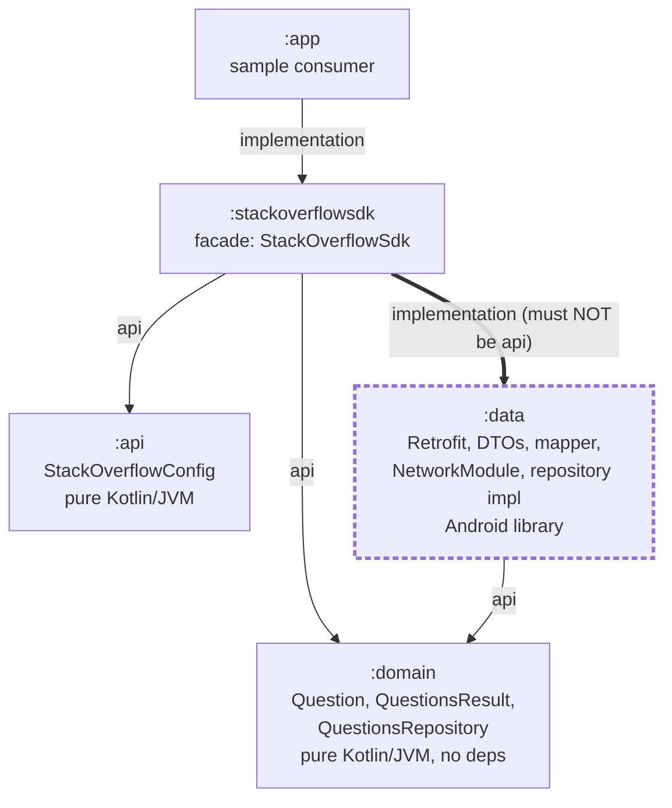
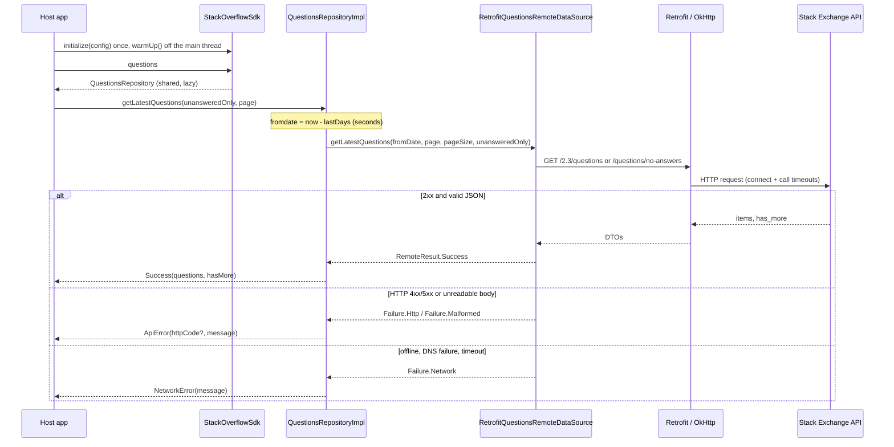
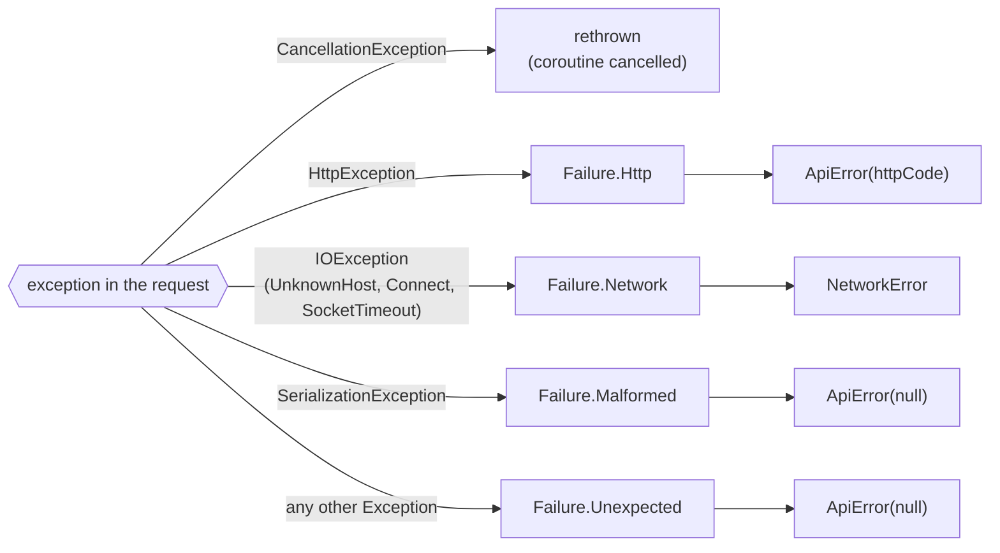
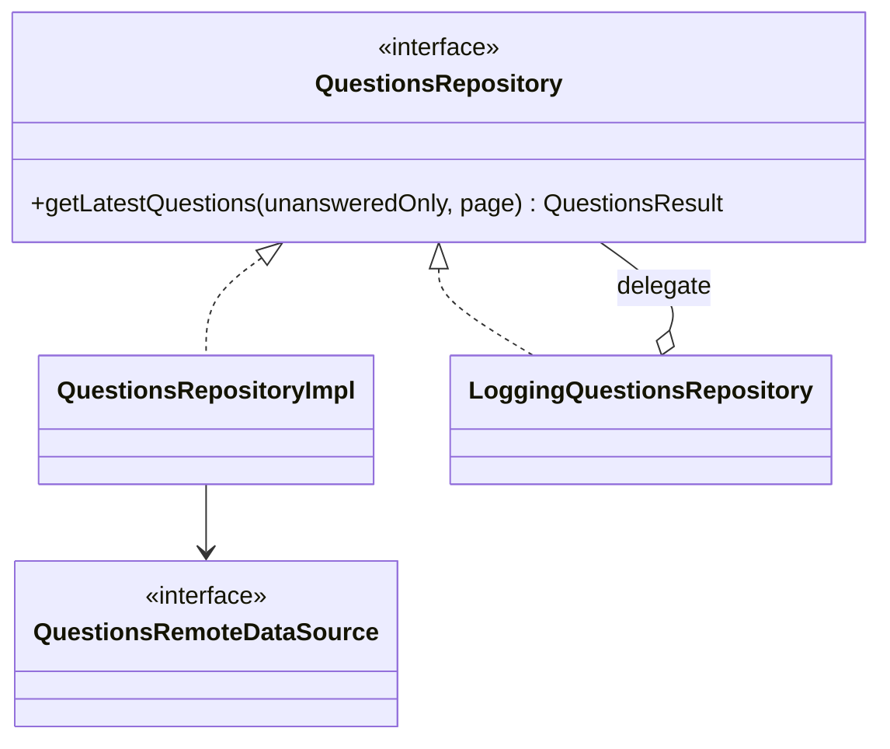

# StackOverflow Home Assignment

An Android **SDK** that retrieves the latest StackOverflow questions, built for the Callsign
**[Mobile Engineer] Home Assignment**, plus a sample app that consumes it.

The assignment asks for an app listing the latest StackOverflow questions, with an "unanswered"
filter and a detail view, where **the retrieval logic is extracted into a library module** that any
app can reuse. This project puts the weight on that library: a small, stable, hard-to-misuse SDK.

> **Status.** The SDK (`:stackoverflowsdk` + `:api` + `:domain` + `:data`) is implemented and tested. The
> sample app screens are in progress, see [Roadmap](#roadmap).

---

## Highlights

- **SDK first**: the app only depends on one artifact, `:stackoverflowsdk`.
- **Minimal public surface**: one entry point, one config class, one repository interface, one
  model and one result type. Everything else is `internal`.
- **Never throws across the SDK boundary**: every failure is a `QuestionsResult` case.
- **Explicit API mode** (`explicitApi()`): the compiler forces every public declaration to be
  deliberate.
- **Multi-module Gradle project**, no convention plugins (kept simple on purpose for a small project).
- **Configure once**: `StackOverflowSdk.initialize(config)` in `Application`, cheap and thread-safe,
  with a `warmUp()` the host can run off the main thread. Using the SDK without it is safe.
- **Optional logging**: off by default, one switch (`loggingEnabled`) that writes to Logcat; the
  log lines never contain content.
- **Explicit timeouts** and **coroutine-cancellation aware**: slow or missing networks fail fast
  as `NetworkError`, cancelled requests stop cleanly.
- **Unit tests**: `MockWebServer` + Robolectric for the networking layer, plain JUnit elsewhere.

---

## Dependency conflicts: the main trade-off

> [!WARNING]
> **Retrofit/OkHttp are hidden at compile time, not at runtime.**
>
> In `:stackoverflowsdk:data`, Retrofit, OkHttp and kotlinx.serialization are declared with
> `implementation`, so host apps **cannot import or accidentally use them**, and changing them is
> not a breaking change for the public API.
>
> **But** that only affects the *compile classpath*. At *runtime* the SDK's transitive dependencies
> end up in the host app's dependency graph, and **Gradle resolves each library to a single
> version, the highest one requested by anyone**. If the host app uses a different OkHttp or
> Retrofit version, the SDK runs against *the host's resolved version*, not the one it was built
> and tested with. A binary-incompatible change between the two can crash **inside the host app**.

This is a real risk for any SDK that embeds third-party libraries, and it is the main reason an
SDK should keep its dependency set small.

**Why I still use Retrofit here.** It is the de-facto standard, the assignment allows third-party
libraries, and the risk is contained:

- Retrofit/OkHttp never appear in a public signature, so the exposure is limited to the runtime
  version resolution described above.
- All network access sits behind a single internal service (`StackExchangeService`) and the
  `QuestionsRepository` contract, so the HTTP stack can be replaced without touching consumers.
- The facade module declares **no unnecessary dependencies** (no AppCompat, Material, ...).

**What I would do in production** (not done here to keep the scope reasonable):

| Option | Idea | Cost |
|---|---|---|
| No third-party HTTP stack | `HttpURLConnection` + `org.json` / minimal parser, only platform APIs | More code to own and test |
| Relocation (shading) | Repackage OkHttp/Retrofit under the SDK's own package at build time so the host's version can never clash | Build complexity, larger binary, not trivial for AARs |
| Pin and document | Publish the exact tested versions and the supported range | Pushes work to integrators |
| Compatibility tests | CI matrix that builds a sample host against several OkHttp/Retrofit versions | CI time |

---

## Architecture

### Module dependencies



`api` edges are visible to the host app, `implementation` edges are not. The thick edge is the one
the IMPORTANT note below is about.

### Request flow



### Error mapping

Two steps, each with one responsibility. The data source is the only place that knows Retrofit's
exceptions; the repository only knows `RemoteResult`.



Only the first case leaves the SDK as an exception, and it is handled by the coroutines runtime.

- `:api` holds the public configuration (`StackOverflowConfig`), pure Kotlin/JVM.
- `:domain` is pure Kotlin/JVM with **zero third-party dependencies**. The repository contract only
  uses `suspend`, so it does not even expose coroutines.
- `:data` hides networking, in three small layers: `QuestionsRepositoryImpl` (public results) →
  `QuestionsRemoteDataSource` (an interface; transport failures as `RemoteResult`) → the Retrofit
  service. The repository does not import Retrofit, so the HTTP stack can be swapped or faked
  without touching it. Its only public symbol is `createQuestionsRepository()`.
- `:stackoverflowsdk` is the only module apps declare. It re-exports `:domain` with `api(...)`, so
  integrators get the models without declaring `:domain` themselves, and keeps `:data` as
  `implementation`, so integrators cannot see it.
- Rule: no `:data` type may appear in a public signature of the facade, otherwise `implementation`
  would not be enough.

> [!IMPORTANT]
> **`:data` must stay `implementation` in `:stackoverflowsdk/build.gradle.kts`, never `api`.**
> That single keyword is what keeps Retrofit, OkHttp, the DTOs and `createQuestionsRepository()`
> invisible to host apps. There is no opt-in marker or other safeguard behind it: if it were
> changed to `api(...)`, they would silently become part of the public API (and a breaking change
> every time they change). A comment in the build file warns about it, and a code review should
> reject any change to this line.

### Why is `createQuestionsRepository()` public?

Kotlin's `internal` is scoped to a **Gradle module**, so the facade cannot see `internal`
declarations of `:data`. The one symbol it needs, `createQuestionsRepository()`, must therefore be
`public`. A host app still cannot reach it: `:stackoverflowsdk` declares `:data` with
`implementation`, so the module is not on the app's compile classpath. The KDoc states that it is
not part of the supported API.

> A `@RequiresOptIn` marker would add a second layer of protection (useful if `:data` were ever
> exposed with `api(...)` or published as its own artifact). It was left out on purpose to keep the
> public surface and the amount of concepts small.

### Design patterns

Where each pattern is used in the SDK, and why. Only things that exist in the code are listed, and
they are labelled for what they are.

**Design patterns (GoF)**

| Pattern | Where | Why |
|---|---|---|
| **Facade** | `StackOverflowSdk` | One simple, stable entry point in front of Retrofit, DTOs, mappers and the HTTP client |
| **Singleton** (with limits) | `StackOverflowSdk` (`object`) | Configure once at startup (`initialize`) and share one client |
| **Decorator** | `LoggingQuestionsRepository` | Add logging around the repository without touching it, and only when enabled |

**Architectural patterns**

| Pattern | Where | Why |
|---|---|---|
| **Repository** + remote **data source** | `QuestionsRepositoryImpl` → `QuestionsRemoteDataSource` | The repository maps outcomes to public results; the data source owns the transport |
| **Dependency injection** by constructor, with a **composition root** | `createQuestionsRepository`, `NetworkModule` | The one place where the object graph is assembled, with no DI framework in the SDK |

**Idioms, not patterns:** sealed result types (`QuestionsResult`, `RemoteResult`) make errors values
the caller must handle instead of exceptions; mapping functions (`QuestionDto.toDomain()`) keep
the wire format out of the public model.

**Facade.** The SDK has several moving parts (Retrofit service, DTOs, mappers, HTTP client,
repository). The *facade* pattern hides them behind one simple, stable entry point,
`StackOverflowSdk`, which hands out a `QuestionsRepository`. The host app does not know what is
behind it, so internals can change (even the whole HTTP stack) without breaking integrators. For an
SDK this matters twice: it keeps the public surface minimal, and it gives one place to enforce
rules (validated config, no exceptions across the boundary).

**Singleton, with a conscious trade-off.** `StackOverflowSdk` is a Kotlin `object`: one well-known
access point that needs no instance and no `Context`, which is how most SDKs are configured once at
startup. Since `initialize` and the shared `questions` property exist, **it now holds state**, and that has
a price: global mutable state is harder to test and allows one configuration per process. How it is
contained:

- The shared state is tiny (the configuration and one repository) and guarded by a lock.
- `initialize` is **once-only**: later or late calls are ignored (and return `false`), so a running
  SDK never changes underneath its callers.
- Using `StackOverflowSdk.questions` without `initialize` falls back to the defaults, it never throws.
- `create(config)` still returns an **independent instance** ignoring the shared state: use it in
  tests, for several configurations, or with your own DI container (the sample app does this
  through Hilt).
- Tests reset the shared state through an `internal` function that is not part of the public API.

**Decorator.** `LoggingQuestionsRepository` is not a subclass of the real repository: it
**wraps** it. Both implement `QuestionsRepository`; the decorator holds the real one as `delegate`,
calls it, writes one log line and returns the same result. The caller cannot tell the difference.



The factory builds it only when `loggingEnabled` is `true`:
`LoggingQuestionsRepository(QuestionsRepositoryImpl(...), sink)`. Why a decorator and not logging
inside the repository or a subclass:

- **One responsibility per class**: the repository maps results and knows nothing about logging.
- **Zero cost when off**: with logging disabled the decorator is never created.
- **Testable alone**: its tests use a fake repository, no network.
- **No inheritance**: a subclass would depend on the base class internals and force it to be `open`.

The price: every new method of `QuestionsRepository` must also be added to the decorator. The
compiler enforces it, so it cannot be forgotten.

---

## Public API

```kotlin
// Add to your app
implementation(project(":stackoverflowsdk"))

// import com.alexfin90.stackoverflowsdk.StackOverflowSdk
// import com.alexfin90.stackoverflowsdk.api.StackOverflowConfig
// 1. Application.onCreate: configure once. Cheap, no I/O, no extra thread.
StackOverflowSdk.initialize(StackOverflowConfig(callTimeoutSeconds = 20, loggingEnabled = BuildConfig.DEBUG))
// 2. Optional: build the HTTP stack off the main thread so the first request is not slower.
applicationScope.launch { StackOverflowSdk.warmUp() }

// 3. Anywhere:
when (val result = StackOverflowSdk.questions.getLatestQuestions(unansweredOnly = true, page = 1)) {
    is QuestionsResult.Success      -> show(result.questions, canLoadMore = result.hasMore)
    is QuestionsResult.NetworkError -> showOffline(result.message)
    is QuestionsResult.ApiError     -> showError(result.httpCode, result.message)
}
```

`initialize` and `warmUp` are optional: `StackOverflowSdk.questions` works with the defaults. If you
prefer to own the instance (tests, DI container, several configurations), use
`StackOverflowSdk.create(config)` instead.

| Type | Role |
|---|---|
| `StackOverflowSdk.initialize(config)` | Sets the configuration once. Cheap. Returns `true` if applied, `false` if ignored (already initialized or already in use). |
| `StackOverflowSdk.questions` | Shared `QuestionsRepository`, built lazily and thread-safe. Uses the defaults if `initialize` was never called. |
| `StackOverflowSdk.warmUp()` | Builds the shared repository now. Idempotent. Call it **off the main thread**: the SDK creates no threads of its own. |
| `StackOverflowSdk.create(config)` | Independent repository, ignores `initialize`. Keep and reuse the instance. |
| `StackOverflowConfig` | `baseUrl`, `pageSize` (1..100), `lastDays` (30), `connectTimeoutSeconds` (10), `callTimeoutSeconds` (30), `loggingEnabled` (false). Validated at construction. |
| `QuestionsRepository` | `suspend fun getLatestQuestions(unansweredOnly, page): QuestionsResult` |
| `QuestionsResult` | Sealed: `Success(questions, hasMore)` / `NetworkError` / `ApiError(httpCode?, message)` |
| `Question` | Plain domain model, independent from the wire format. Title is already HTML-decoded. |

### Initialization rules

1. **Only the first `initialize` takes effect**, and only if the shared repository was not used yet.
   Any other call returns `false` and, if logging is enabled, logs a warning. The configuration of a
   running SDK never changes.
2. **Using the SDK without `initialize` is safe**: the defaults apply, nothing throws. The first
   access then freezes that default configuration.
3. **`initialize` does not block**: it validates and stores the configuration. The expensive part
   (OkHttp client, Retrofit) is built on first use or in `warmUp()`, on the caller's thread.

### Logging

Off by default: a library should be silent unless the host asks.

```kotlin
// Logcat, tag "StackOverflowSdk"
StackOverflowConfig(loggingEnabled = BuildConfig.DEBUG)
```

One line per request, for example
`getLatestQuestions(unansweredOnly=true, page=2) -> Success(items=20, hasMore=true) in 312 ms`.
`DEBUG` for success, `WARN` for no connection, `ERROR` for an API error.

- **What is logged**: the operation, its parameters, the kind of outcome, counts and duration.
- **What is never logged**: response bodies, titles, authors, or exception messages (they can echo
  server content). This is covered by a test.
- **Logging cannot break the SDK**: a failure while writing the line (e.g. Logcat unavailable) is
  swallowed.
- **No custom logger on purpose**: a switch is enough for the need, and a pluggable logger would be
  one more public type to keep stable. If a host needs to route the lines elsewhere (Timber, a file),
  an optional `logger` parameter can be added later without breaking anyone.
- Implemented as a decorator (`LoggingQuestionsRepository`) that is only created when logging is
  enabled, so the default path pays nothing and the repository stays free of logging code.

### Coroutine cancellation

`getLatestQuestions` is cancellable and rethrows `CancellationException` instead of converting it
to a result: swallowing it would leave a cancelled coroutine running. It can happen when:

- the user leaves the screen while the request is in flight and `viewModelScope` is cancelled;
- the user changes the filter and the previous job is cancelled (`collectLatest`, `Job.cancel()`);
- a `withTimeout` expires (`TimeoutCancellationException` is a subclass);
- a `LaunchedEffect` in Compose leaves the composition or its key changes.

It never crashes the host: the coroutines runtime handles it. It is the only exception that can
leave the SDK.

### Design decisions

- **Errors are values, not exceptions.** An exception thrown by the SDK would show up as a crash of
  the *host* app. The data source catches everything (including the unexpected) and turns it into
  a `RemoteResult`; the repository maps that to a `QuestionsResult`. The only exception rethrown is
  `CancellationException`, to respect structured concurrency.
- **No `Context`; initialization is optional and non-blocking.** `initialize` only stores a
  validated configuration, so nothing blocks the host's startup or leaks an `Activity`.
- **Config validated eagerly.** An invalid configuration is a programming error in the host, so it
  fails fast with a clear message instead of failing at the first request.
- **Unanswered filter uses the dedicated endpoint** (`/questions/no-answers`) so the filtering is
  done by the server and pagination stays correct.
- **No DI framework inside the SDK.** Hilt/Dagger would be imposed on the host (annotation
  processing, application class, version conflicts). Testability comes from plain constructor
  injection (`QuestionsRepositoryImpl` receives its data source, the data source receives the service). Hilt is a good fit for the *sample
  app*, where it will be used.
- **Timeouts are explicit.** Connect timeout (default 10 s) makes the SDK fail fast on a dead
  network; call timeout (default 30 s) caps the whole request. A timeout is an `IOException`, so it
  becomes `QuestionsResult.NetworkError`, same as offline or DNS failure (`UnknownHostException`).
- **`:data` is an Android library, `:domain` is pure JVM.** Only the contract needs to be
  framework-free. `:data` uses `Html.fromHtml` to decode HTML entities in titles; its tests run
  with Robolectric.
- **No offline cache.** Out of scope: the SDK stays stateless (a database would add dependencies
  and conflict risk). A cache would live in the app (e.g. Room as source of truth with a fallback
  on `NetworkError`) or as an optional OkHttp HTTP cache.
- **`minSdk` 24**, to keep the SDK integrable by apps with a low minimum.
- **INTERNET permission** is declared in the SDK manifest and merged into the host app.

---

## Stack Exchange API used

Base URL `https://api.stackexchange.com/` (v2.3). Both calls are `GET`, anonymous, and return JSON.

| Use case | Endpoint | Docs |
|---|---|---|
| Latest questions | `/2.3/questions` | [docs](https://api.stackexchange.com/docs/questions) |
| Unanswered questions (0 answers) | `/2.3/questions/no-answers` | [docs](https://api.stackexchange.com/docs/no-answer-questions) |

| Query parameter | Value | Why |
|---|---|---|
| `site` | `stackoverflow` | Fixed, defines the target site |
| `sort` / `order` | `creation` / `desc` | Fixed, "latest" means newest first |
| `fromdate` | now minus `lastDays`, Unix time in **seconds** | Requirement: questions of the last 30 days. 1 day = 86,400 s |
| `page` / `pagesize` | from the caller / `StackOverflowConfig.pageSize` | Paging (`has_more` tells if another page exists) |

Fields read from each item: `question_id`, `title` (HTML-encoded, decoded by the SDK), `link`,
`creation_date`, `answer_count`, `score`, `owner.display_name`, `tags`. Unknown fields are ignored,
so API additions do not break the SDK.

Things to know about the API: anonymous requests are rate limited (the quota is small and shared
per IP), and an exhausted quota or a bad request comes back as an HTTP error with a JSON body,
which the SDK reports as `QuestionsResult.ApiError`. The `fromdate` window is recomputed on each
call, so it slides slightly between pages.

---

## Module Structure

```
StackOverFlow Home Assignment
├── app                       # Sample consumer app (Compose)
└── stackoverflowsdk          # Facade (Android library): StackOverflowSdk
    ├── api                   # Public configuration: StackOverflowConfig (pure JVM)
    ├── domain                # Question, QuestionsResult, QuestionsRepository (pure JVM)
    └── data                  # Retrofit service, DTOs, mapper, repository impl (Android library)
```

---

## Tech Stack

- **Language**: Kotlin `2.2.10`, JDK `17` (Gradle toolchain)
- **Build**: AGP `9.3.3`, Gradle version catalog (no convention plugins)
- **Networking**: Retrofit `3.0.0`, OkHttp `4.12.0` (explicit timeouts), kotlinx.serialization `1.10.0`
- **Async**: Kotlin Coroutines `1.10.2`
- **Testing**: JUnit 4, Robolectric `4.14.1`, `MockWebServer`, `kotlinx-coroutines-test`
- **Android**: `minSdk` 24, `compileSdk` 37

---

## Running the Project

### Requirements

- Android Studio (recent stable)
- JDK 17+ to run Gradle. The build compiles with a JDK 17 toolchain and downloads it automatically
  (foojay resolver) if it is not installed.

### Build and test

```bash
./gradlew :app:assembleDebug                 # build the sample app (and the SDK)
./gradlew :stackoverflowsdk:data:testDebugUnitTest # networking layer tests (MockWebServer + Robolectric)
./gradlew :stackoverflowsdk:api:test               # config tests
./gradlew :stackoverflowsdk:testDebugUnitTest      # facade tests
```

---

## Testing

- **Mapper**: HTML entity decoding (numeric, hex, named, no double decoding), DTO to domain mapping.
- **Remote data source** (against `MockWebServer`): endpoint and query parameters (30-day window,
  paging, `no-answers` for the filter), unknown fields ignored, HTTP error, malformed body,
  connection failure, unknown host.
- **Repository** (against a fake data source, no HTTP): DTO to domain mapping, the `fromdate` window
  and the parameters passed down, every failure kind mapped to the right result.
- **Wiring**: three end-to-end cases through the public factory.
- **Logging decorator**: exact line format, levels, no content in the lines, a failing sink and a
  cancellation do not break the request.
- **Config** (`:api`): defaults, logging off by default, validation.
- **Facade**: `initialize` applied once, ignored when repeated or late (with a warning), use without
  `initialize`, shared instance, `warmUp` idempotent, concurrent access builds one instance,
  `create()` independent.

### Why Robolectric?

Plain JVM unit tests run against `android.jar`, whose framework classes are **stubs**: calling them
fails with `Method ... not mocked`. [Robolectric](https://robolectric.org) is a test runner
(`@RunWith(RobolectricTestRunner::class)`) that replaces those stubs with real implementations of
the Android framework, so code that needs `Context`, `Bundle`, `Html`, ... runs on the JVM without
an emulator. It is declared with `testImplementation`, so **it is never shipped with the SDK**.

It is a common need in apps too (for example a ViewModel using `SavedStateHandle`, which relies on
`Bundle`). Here it is needed because the mapper uses `Html.fromHtml` to decode HTML entities in
titles, and the repository tests go through the mapper.

> [!NOTE]
> **Trade-off:** `Html.fromHtml` is more complete than a hand-written decoder, but it makes every
> test that touches the mapper run under Robolectric. Cost: slower test runs (about 37 s for the
> first run on my machine, as Robolectric downloads the Android jars) and network access on the
> very first run on a new machine. If this becomes a problem, the alternative is a small
> hand-written decoder in pure Kotlin (only the few entities the API emits), which lets `:data`
> go back to being a plain JVM module with plain JUnit tests.

---

## Roadmap

Work is delivered step by step through pull requests.

- [x] Module structure (facade, domain, data), explicit API mode
- [x] Domain models, result type and repository contract
- [x] Data layer: Retrofit service, DTOs, mapper, repository, tests
- [x] Facade (`StackOverflowSdk`, `StackOverflowConfig`) and README
- [ ] Sample app: list screen with "unanswered" filter and loading state, detail screen
      (Compose, ViewModel, Hilt)
- [ ] App tests: ViewModel unit tests, one happy-path and one unhappy-path UI test
- [ ] Split the app into `feature:home` and `feature:detail` modules

### What I would add with more time (SDK)

- Pluggable HTTP layer / relocation to remove the runtime dependency risk described above
- Response caching and retry with backoff for transient failures
- Structured logging with a session id and PII-free diagnostics hook
- Binary-compatibility validation (`binary-compatibility-validator`) and a published changelog
  with semantic versioning and a deprecation policy
- `Flow`-based API for paging/refresh on top of the current `suspend` contract

---

## Notes

This repository is private, as required by the assignment.
