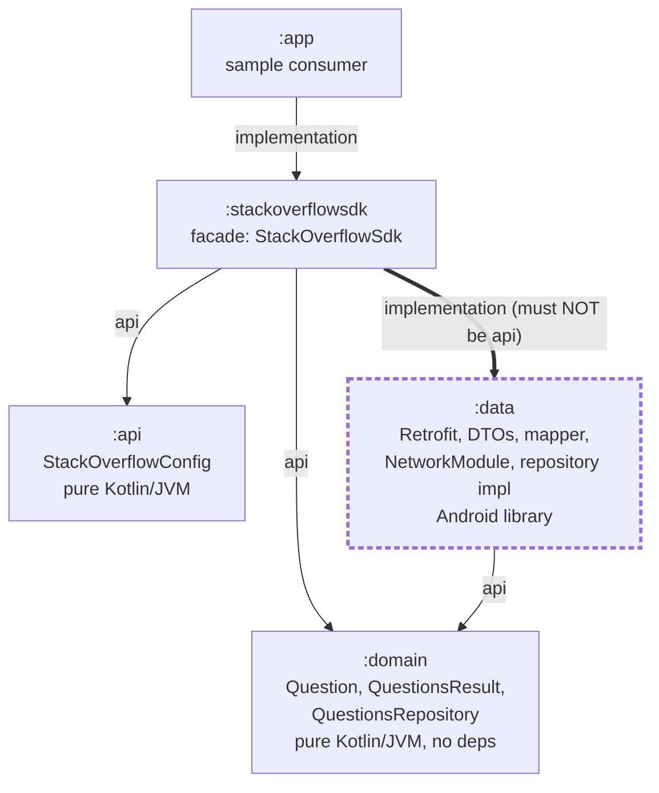
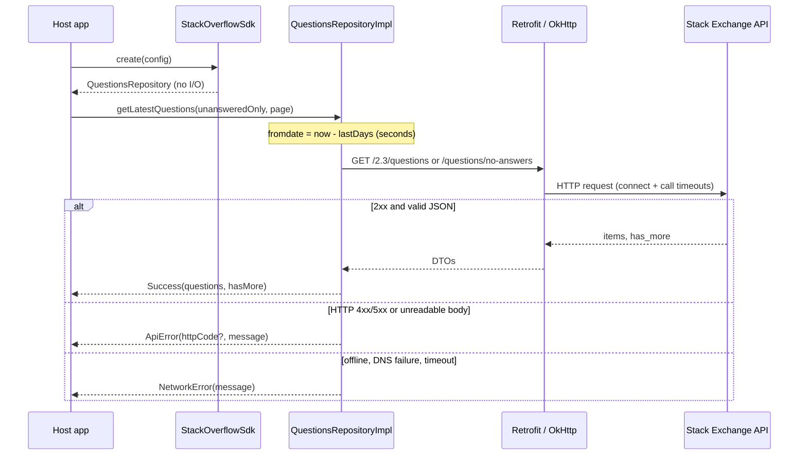
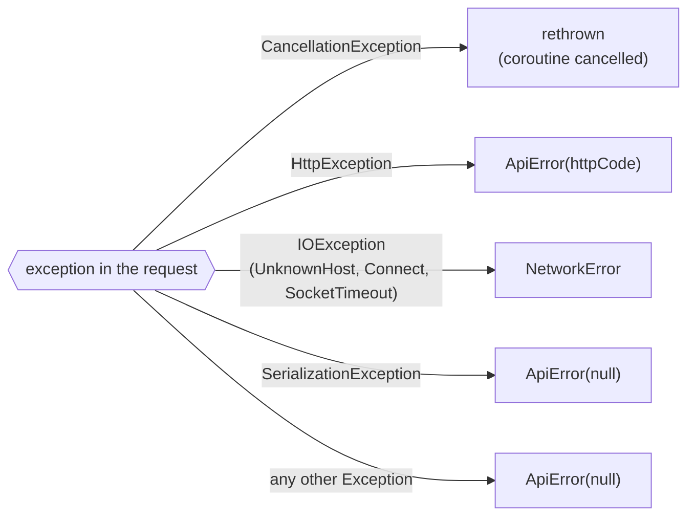
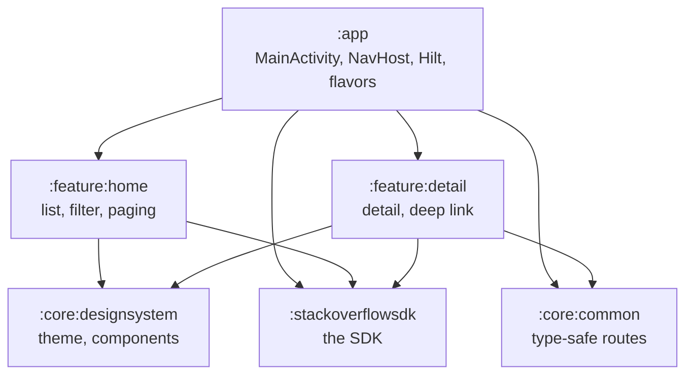

# StackOverflow Home Assignment

An Android **SDK** that retrieves the latest StackOverflow questions, built for the Callsign
**[Mobile Engineer] Home Assignment**, plus a sample app that consumes it.

The assignment asks for an app listing the latest StackOverflow questions, with an "unanswered"
filter and a detail view, where **the retrieval logic is extracted into a library module** that any
app can reuse. This project puts the weight on that library: a small, stable, hard-to-misuse SDK.

> **Status.** The SDK (`:stackoverflowsdk` + `:api` + `:domain` + `:data`) and the sample app
> (list with "unanswered" filter, detail screen, deep link, `mock`/`real` flavors) are implemented,
> with 52 unit/UI tests. It was also checked by hand on an Android emulator (list on the `real`
> flavor, detail through the deep link on `mock`), but **not on a physical device**, see
> [Known limitations](#known-limitations).

---

## Highlights

- **SDK first**: the app only depends on one artifact, `:stackoverflowsdk`.
- **Minimal public surface**: one entry point, one config class, one repository interface, one
  model and one result type. Everything else is `internal`.
- **Never throws across the SDK boundary**: every failure is a `QuestionsResult` case.
- **Explicit API mode** (`explicitApi()`): the compiler forces every public declaration to be
  deliberate.
- **Multi-module Gradle project**, no convention plugins (kept simple on purpose for a small project).
- **Explicit timeouts** and **coroutine-cancellation aware**: slow or missing networks fail fast
  as `NetworkError`, cancelled requests stop cleanly.
- **Unit tests**: `MockWebServer` + Robolectric for the networking layer, plain JUnit elsewhere.
- **Sample app** with the same modular layout as a production app (`feature:*`, `core:*`), Hilt,
  immutable UI state, `mock`/`real` flavors, a deep link and Compose UI tests that run on the JVM.

---

## Dependency conflicts: the main trade-off

> [!WARNING]
> **Retrofit/OkHttp are hidden at compile time, not at runtime.**
>
> In `:stackoverflowsdk:data`, Retrofit, OkHttp and kotlinx.serialization are declared with
> `implementation`, so host apps **cannot import or accidentally use them**, and changing them is
> not a breaking change for the public API.
>
> **But** that only affects the *compile classpath*. At *runtime* the SDK's transitive dependencies
> end up in the host app's dependency graph, and **Gradle resolves each library to a single
> version, the highest one requested by anyone**. If the host app uses a different OkHttp or
> Retrofit version, the SDK runs against *the host's resolved version*, not the one it was built
> and tested with. A binary-incompatible change between the two can crash **inside the host app**.

This is a real risk for any SDK that embeds third-party libraries, and it is the main reason an
SDK should keep its dependency set small.

**Why I still use Retrofit here.** It is the de-facto standard, the assignment allows third-party
libraries, and the risk is contained:

- Retrofit/OkHttp never appear in a public signature, so the exposure is limited to the runtime
  version resolution described above.
- All network access sits behind a single internal service (`StackExchangeService`) and the
  `QuestionsRepository` contract, so the HTTP stack can be replaced without touching consumers.
- The facade module declares **no unnecessary dependencies** (no AppCompat, Material, ...).

**What I would do in production** (not done here to keep the scope reasonable):

| Option | Idea | Cost |
|---|---|---|
| No third-party HTTP stack | `HttpURLConnection` + `org.json` / minimal parser, only platform APIs | More code to own and test |
| Relocation (shading) | Repackage OkHttp/Retrofit under the SDK's own package at build time so the host's version can never clash | Build complexity, larger binary, not trivial for AARs |
| Pin and document | Publish the exact tested versions and the supported range | Pushes work to integrators |
| Compatibility tests | CI matrix that builds a sample host against several OkHttp/Retrofit versions | CI time |

---

## Architecture

### Module dependencies



`api` edges are visible to the host app, `implementation` edges are not. The thick edge is the one
the IMPORTANT note below is about.

### Request flow



### Error mapping



Only the first case leaves the SDK as an exception, and it is handled by the coroutines runtime.

- `:api` holds the public configuration (`StackOverflowConfig`), pure Kotlin/JVM.
- `:domain` is pure Kotlin/JVM with **zero third-party dependencies**. The repository contract only
  uses `suspend`, so it does not even expose coroutines.
- `:data` hides networking. Its only public symbol is `createQuestionsRepository()`.
- `:stackoverflowsdk` is the only module apps declare. It re-exports `:domain` with `api(...)`, so
  integrators get the models without declaring `:domain` themselves, and keeps `:data` as
  `implementation`, so integrators cannot see it.
- Rule: no `:data` type may appear in a public signature of the facade, otherwise `implementation`
  would not be enough.

> [!IMPORTANT]
> **`:data` must stay `implementation` in `:stackoverflowsdk/build.gradle.kts`, never `api`.**
> That single keyword is what keeps Retrofit, OkHttp, the DTOs and `createQuestionsRepository()`
> invisible to host apps. There is no opt-in marker or other safeguard behind it: if it were
> changed to `api(...)`, they would silently become part of the public API (and a breaking change
> every time they change). A comment in the build file warns about it, and a code review should
> reject any change to this line.

### Why is `createQuestionsRepository()` public?

Kotlin's `internal` is scoped to a **Gradle module**, so the facade cannot see `internal`
declarations of `:data`. The one symbol it needs, `createQuestionsRepository()`, must therefore be
`public`. A host app still cannot reach it: `:stackoverflowsdk` declares `:data` with
`implementation`, so the module is not on the app's compile classpath. The KDoc states that it is
not part of the supported API.

> A `@RequiresOptIn` marker would add a second layer of protection (useful if `:data` were ever
> exposed with `api(...)` or published as its own artifact). It was left out on purpose to keep the
> public surface and the amount of concepts small.

### Patterns: Facade and Singleton

**Facade.** The SDK has several moving parts (Retrofit service, DTOs, mappers, HTTP client,
repository). The *facade* pattern hides them behind one simple, stable entry point:
`StackOverflowSdk.create(config)`, which returns a `QuestionsRepository`. The host app does not
know what is behind it, so internals can change (even the whole HTTP stack) without breaking
integrators. For an SDK this matters twice: it keeps the public surface minimal, and it gives one
place to enforce rules (validated config, no exceptions across the boundary).

**Singleton.** `StackOverflowSdk` is a Kotlin `object`, i.e. a singleton used as the entry point:
one well-known, always available access point that needs no instance and no `Context`. A common
SDK practice is also to build the expensive objects (the HTTP client and its connection pool) once
and reuse them. Two conscious choices here:

- The `object` is **stateless**: it only creates repositories. Global mutable state in a singleton
  hurts testability and makes it impossible to have two configurations in the same process.
- The *repository* is **not** forced to be a singleton: `create()` returns a new instance and the
  caller keeps it (typically one per app, provided through DI in the sample app). This keeps tests
  isolated and the SDK free of hidden global state.

---

## Public API

```kotlin
// Add to your app
implementation(project(":stackoverflowsdk"))

// import com.alexfin90.stackoverflowsdk.StackOverflowSdk
// import com.alexfin90.stackoverflowsdk.api.StackOverflowConfig   (optional)
val questions: QuestionsRepository = StackOverflowSdk.create()   // no I/O, no Context

when (val result = questions.getLatestQuestions(unansweredOnly = true, page = 1)) {
    is QuestionsResult.Success      -> show(result.questions, canLoadMore = result.hasMore)
    is QuestionsResult.NetworkError -> showOffline(result.message)
    is QuestionsResult.ApiError     -> showError(result.httpCode, result.message)
}
```

| Type | Role |
|---|---|
| `StackOverflowSdk.create(config)` | Single entry point. Cheap, does no I/O. |
| `StackOverflowConfig` | `baseUrl`, `pageSize` (1..100), `lastDays` (default 30), `connectTimeoutSeconds` (10), `callTimeoutSeconds` (30). Validated at construction. |
| `QuestionsRepository` | `suspend fun getLatestQuestions(unansweredOnly, page): QuestionsResult` and `suspend fun getQuestion(id): QuestionResult` |
| `QuestionsResult` | Sealed: `Success(questions, hasMore)` / `NetworkError` / `ApiError(httpCode?, message)` |
| `QuestionResult` | Same idea for one question: `Success(question)` / `NotFound` / `NetworkError` / `ApiError` |
| `Question` | Plain domain model, independent from the wire format. Title is already HTML-decoded. |

### Coroutine cancellation

`getLatestQuestions` is cancellable and rethrows `CancellationException` instead of converting it
to a result: swallowing it would leave a cancelled coroutine running. It can happen when:

- the user leaves the screen while the request is in flight and `viewModelScope` is cancelled;
- the user changes the filter and the previous job is cancelled (`collectLatest`, `Job.cancel()`);
- a `withTimeout` expires (`TimeoutCancellationException` is a subclass);
- a `LaunchedEffect` in Compose leaves the composition or its key changes.

It never crashes the host: the coroutines runtime handles it. It is the only exception that can
leave the SDK.

### Design decisions

- **Errors are values, not exceptions.** An exception thrown by the SDK would show up as a crash of
  the *host* app. The repository catches everything (including the unexpected) and maps it to a
  `QuestionsResult`. The only exception rethrown is `CancellationException`, to respect structured
  concurrency.
- **No `Context`, no initialization step.** Nothing blocks the host's startup or leaks an
  `Activity`.
- **Config validated eagerly.** An invalid configuration is a programming error in the host, so it
  fails fast with a clear message instead of failing at the first request.
- **Unanswered filter uses the dedicated endpoint** (`/questions/no-answers`) so the filtering is
  done by the server and pagination stays correct.
- **No DI framework inside the SDK.** Hilt/Dagger would be imposed on the host (annotation
  processing, application class, version conflicts). Testability comes from plain constructor
  injection (`QuestionsRepositoryImpl` receives its service). Hilt is a good fit for the *sample
  app*, where it will be used.
- **Timeouts are explicit.** Connect timeout (default 10 s) makes the SDK fail fast on a dead
  network; call timeout (default 30 s) caps the whole request. A timeout is an `IOException`, so it
  becomes `QuestionsResult.NetworkError`, same as offline or DNS failure (`UnknownHostException`).
- **`:data` is an Android library, `:domain` is pure JVM.** Only the contract needs to be
  framework-free. `:data` uses `Html.fromHtml` to decode HTML entities in titles; its tests run
  with Robolectric.
- **No offline cache.** Out of scope: the SDK stays stateless (a database would add dependencies
  and conflict risk). A cache would live in the app (e.g. Room as source of truth with a fallback
  on `NetworkError`) or as an optional OkHttp HTTP cache.
- **`minSdk` 24**, to keep the SDK integrable by apps with a low minimum.
- **INTERNET permission** is declared in the SDK manifest and merged into the host app.

---

## Stack Exchange API used

Base URL `https://api.stackexchange.com/` (v2.3). Both calls are `GET`, anonymous, and return JSON.

| Use case | Endpoint | Docs |
|---|---|---|
| Latest questions | `/2.3/questions` | [docs](https://api.stackexchange.com/docs/questions) |
| Unanswered questions (0 answers) | `/2.3/questions/no-answers` | [docs](https://api.stackexchange.com/docs/no-answer-questions) |
| One question by id (detail, deep link) | `/2.3/questions/{id}` | [docs](https://api.stackexchange.com/docs/questions-by-ids) |

| Query parameter | Value | Why |
|---|---|---|
| `site` | `stackoverflow` | Fixed, defines the target site |
| `sort` / `order` | `creation` / `desc` | Fixed, "latest" means newest first |
| `fromdate` | now minus `lastDays`, Unix time in **seconds** | Requirement: questions of the last 30 days. 1 day = 86,400 s |
| `page` / `pagesize` | from the caller / `StackOverflowConfig.pageSize` | Paging (`has_more` tells if another page exists) |

Fields read from each item: `question_id`, `title` (HTML-encoded, decoded by the SDK), `link`,
`creation_date`, `answer_count`, `score`, `owner.display_name`, `tags`. Unknown fields are ignored,
so API additions do not break the SDK.

Things to know about the API: anonymous requests are rate limited (the quota is small and shared
per IP), and an exhausted quota or a bad request comes back as an HTTP error with a JSON body,
which the SDK reports as `QuestionsResult.ApiError`. The `fromdate` window is recomputed on each
call, so it slides slightly between pages.

---

## Sample App

The app consumes the SDK like any third party would: through `StackOverflowSdk.create()` and the
public contract only.

| Feature | Notes |
|---|---|
| Latest questions | Last 30 days, newest first, paginated (next page when scrolling near the end) |
| "Unanswered" filter | Chip; calls the dedicated `no-answers` endpoint, selection survives process death |
| Loading / empty / error | Spinner, empty message, network vs server error with **Retry** |
| Detail screen | Title, author, score, answers, tags; **Open in browser** button; loaded by id |
| Deep link | `stackoverflowdemo://question/{questionId}` opens the detail directly |

### Modules



Feature modules never depend on each other: navigation between them lives in `:app`, using the
routes from `:core:common`.

### Product flavors: `mock` and `real`

The flavor is chosen at build time; each one has its own Hilt `SdkModule` in `src/mock` or
`src/real`, so there is no runtime branching.

| Flavor | `SdkModule` binds | Use it when |
|---|---|---|
| `real` | `StackOverflowSdk.create()` | you want the real Stack Exchange API |
| `mock` | `FakeQuestionsRepository` (in-memory data, 800 ms latency) | offline, demos, UI work. **The SDK networking stack is never built.** |

`mock` has the application id suffix `.mock`, so both can be installed side by side.

### Deep link

`stackoverflowdemo://question/{questionId}` opens the detail screen directly. It is declared twice,
as usual: a manifest `intent-filter` (`VIEW`, `BROWSABLE`) and a type-safe
`navDeepLink<Route.QuestionDetail>`. It works because the detail loads **by id**
(`getQuestion(id)` in the SDK): a link carries an id, not a question.

**Try it (emulator or device with USB debugging):**

1. Install the app: `./gradlew :app:installMockDebug` (or `:app:installRealDebug`).
2. Fire the link with `adb`. On macOS `adb` is in `~/Library/Android/sdk/platform-tools/` if it is
   not on your `PATH`.

```bash
# mock flavor: ids 1000..1019 exist, works offline
adb shell am start -a android.intent.action.VIEW \
  -d "stackoverflowdemo://question/1000" \
  -p com.alexfin90.stackoverflowhomeassignment.mock

# real flavor: use any StackOverflow question id, e.g. the number in a question URL
adb shell am start -a android.intent.action.VIEW \
  -d "stackoverflowdemo://question/80007692" \
  -p com.alexfin90.stackoverflowhomeassignment
```

- `-p <package>` selects the app. **Both flavors register the same link**, so if both are installed
  and you omit `-p`, Android shows an app chooser. That is expected.
- Expected result: the detail screen of that question (title, author, answers, tags, "Open in
  browser"). An id that does not exist shows the "does not exist" state, a missing network shows
  the error state with **Retry**.
- To check that the link is registered: `adb shell pm query-activities --brief -a
  android.intent.action.VIEW -d "stackoverflowdemo://question/1000"` lists the matching apps.
- Pressing Back after opening the link directly leaves the app (the graph is flat, see
  [Known limitations](#known-limitations)).

---

### Compose and architecture practices

- **Immutable UI state**: one `StateFlow` per screen of an `@Immutable` state (`sealed interface`
  for loading / error / empty / content), `ImmutableList` instead of `List`.
- **`LazyColumn` with stable `key` and `contentType`**, so items are reused and recomposition stays
  local.
- **State hoisting**: a stateful `*Route` (Hilt ViewModel, `collectAsStateWithLifecycle`) wraps a
  stateless `*Screen` that only takes state and callbacks. That makes screens testable and
  previewable.
- **No `Context` in ViewModels**: formatting with string resources and plurals happens in the UI
  layer.
- **Stale responses cannot win**: changing the filter cancels the in-flight request.
- **Design system without strings or SDK types**: components receive ready-to-render models.
- **Feature modules depend on the SDK contract only**, never on `:data`.

---

## Module Structure

```
StackOverFlow Home Assignment
├── app                       # Sample app: MainActivity, NavHost, Hilt, mock/real flavors
├── core
│   ├── common                # Type-safe routes and deep link base (pure JVM)
│   └── designsystem          # Theme, QuestionRow, filter chip, loading/error/empty states
├── feature
│   ├── home                  # Questions list, filter, paging (ViewModel + screen + tests)
│   └── detail                # Question detail, deep link target (ViewModel + screen + tests)
└── stackoverflowsdk          # Facade (Android library): StackOverflowSdk
    ├── api                   # Public configuration: StackOverflowConfig (pure JVM)
    ├── domain                # Question, QuestionsResult, QuestionsRepository (pure JVM)
    └── data                  # Retrofit service, DTOs, mapper, repository impl (Android library)
```

---

## Tech Stack

- **Language**: Kotlin `2.2.10`, JDK `17` (Gradle toolchain)
- **Build**: AGP `9.3.3`, Gradle version catalog (no convention plugins)
- **Networking**: Retrofit `3.0.0`, OkHttp `4.12.0` (explicit timeouts), kotlinx.serialization `1.10.0`
- **Async**: Kotlin Coroutines `1.10.2`
- **UI**: Jetpack Compose (BOM `2026.02.01`), Material 3, Navigation Compose `2.9.3` (type-safe routes),
  kotlinx-collections-immutable `0.4.0`
- **DI** (app only): Hilt `2.60.1` + KSP `2.3.12`, Hilt Navigation Compose `1.3.0`
- **Testing**: JUnit 4, Robolectric `4.14.1`, `MockWebServer`, `kotlinx-coroutines-test`
- **Android**: `minSdk` 24, `compileSdk` 37

---

## Running the Project

### Requirements

- Android Studio (recent stable)
- JDK 17+ to run Gradle. The build compiles with a JDK 17 toolchain and downloads it automatically
  (foojay resolver) if it is not installed.

### Build and test

```bash
./gradlew :app:installMockDebug     # in-memory data, works offline
./gradlew :app:installRealDebug     # real Stack Exchange API

./gradlew :stackoverflowsdk:data:testDebugUnitTest # networking layer (MockWebServer + Robolectric)
./gradlew :stackoverflowsdk:api:test :stackoverflowsdk:testDebugUnitTest
./gradlew :core:designsystem:testDebugUnitTest :feature:home:testDebugUnitTest :feature:detail:testDebugUnitTest
```

---

## Testing

- **Mapper**: HTML entity decoding (numeric, hex, named, no double decoding), DTO to domain mapping.
- **Repository** (against `MockWebServer`): success mapping, correct endpoint and query parameters
  (30-day window, paging, `no-answers` for the filter), HTTP error, malformed body, connection
  failure, unknown host.
- **Config** (`:api`): defaults and validation.
- **Facade**: `create()` does no I/O.
- **App** (ViewModels and Compose UI): see below.

| Module | Tests | What |
|---|---|---|
| `:stackoverflowsdk:data` | 16 | mapper, repository against `MockWebServer` (list, unanswered, by id, errors) |
| `:stackoverflowsdk:api` | 5 | config defaults and validation |
| `:stackoverflowsdk` | 1 | `create()` does no I/O |
| `:core:designsystem` | 4 | components (Compose UI, JVM) |
| `:feature:home` | 17 | 11 ViewModel + 6 Compose UI (happy and unhappy paths) |
| `:feature:detail` | 9 | 4 ViewModel + 5 Compose UI (happy and unhappy paths) |

**UI tests run on the JVM** (Compose UI test + Robolectric), against the stateless screens. They
need no device or emulator, so they run in CI like unit tests. The trade-off: they do not exercise
real rendering, navigation or the Hilt graph end to end; instrumented tests would cover that.

### Why Robolectric?

Plain JVM unit tests run against `android.jar`, whose framework classes are **stubs**: calling them
fails with `Method ... not mocked`. [Robolectric](https://robolectric.org) is a test runner
(`@RunWith(RobolectricTestRunner::class)`) that replaces those stubs with real implementations of
the Android framework, so code that needs `Context`, `Bundle`, `Html`, ... runs on the JVM without
an emulator. It is declared with `testImplementation`, so **it is never shipped with the SDK**.

It is a common need in apps too (for example a ViewModel using `SavedStateHandle`, which relies on
`Bundle`). Here it is needed because the mapper uses `Html.fromHtml` to decode HTML entities in
titles, and the repository tests go through the mapper.

> [!NOTE]
> **Trade-off:** `Html.fromHtml` is more complete than a hand-written decoder, but it makes every
> test that touches the mapper run under Robolectric. Cost: slower test runs (about 37 s for the
> first run on my machine, as Robolectric downloads the Android jars) and network access on the
> very first run on a new machine. If this becomes a problem, the alternative is a small
> hand-written decoder in pure Kotlin (only the few entities the API emits), which lets `:data`
> go back to being a plain JVM module with plain JUnit tests.

---

## Roadmap

Delivered step by step through stacked pull requests.

- [x] Module structure (facade, api, domain, data), explicit API mode
- [x] Domain models, result type, repository contract and data layer with tests
- [x] Facade, config and README
- [x] SDK: `getQuestion(id)`
- [x] App: Hilt, `mock`/`real` flavors, design system, list + filter, detail + deep link
- [x] Unit tests and UI tests (happy and unhappy paths)

### What I would add with more time (SDK)

- Pluggable HTTP layer / relocation to remove the runtime dependency risk described above
- Response caching and retry with backoff for transient failures
- Structured logging with a session id and PII-free diagnostics hook
- Binary-compatibility validation (`binary-compatibility-validator`) and a published changelog
  with semantic versioning and a deprecation policy
- `Flow`-based API for paging/refresh on top of the current `suspend` contract

### What I would add with more time (app)

- Instrumented tests (Hilt end to end, navigation, deep link) and screenshot tests
- Synthetic back stack so that, after opening the deep link, Back goes to the list
- Show the question body (needs the API `withbody` filter) and answers
- Offline cache (Room as single source of truth) in the app, keeping the SDK stateless
- Paging 3 instead of the hand-written paging, if the list grows in complexity

---

## Known limitations

- Manual checks were limited to an emulator: the list with real data and the detail through the
  deep link on `mock`. Not tried on a physical device. The rest of the behaviour is covered by 52
  tests (UI tests run on the JVM, see [Testing](#testing)).
- "Open in browser" opens the `link` returned by the API. If `stackoverflow.com` blocks your
  network (it can answer 403/503 to some shared IPs, e.g. hotels), the browser shows that error:
  it is not an app issue.
- The `fromdate` window slides between pages, so a question at the edge can appear twice (the app
  de-duplicates by id) or be skipped.
- Anonymous Stack Exchange requests have a small shared quota; when it is exhausted the app shows
  the server error state. An API key is not used.
- Retrofit/OkHttp can still clash with the host's versions at runtime, see
  [Dependency conflicts](#dependency-conflicts-the-main-trade-off).

---

## Notes

This repository is private, as required by the assignment. AI coding tools were used to write
parts of it; the design decisions and trade-offs documented here are reviewed and owned by the
author.
