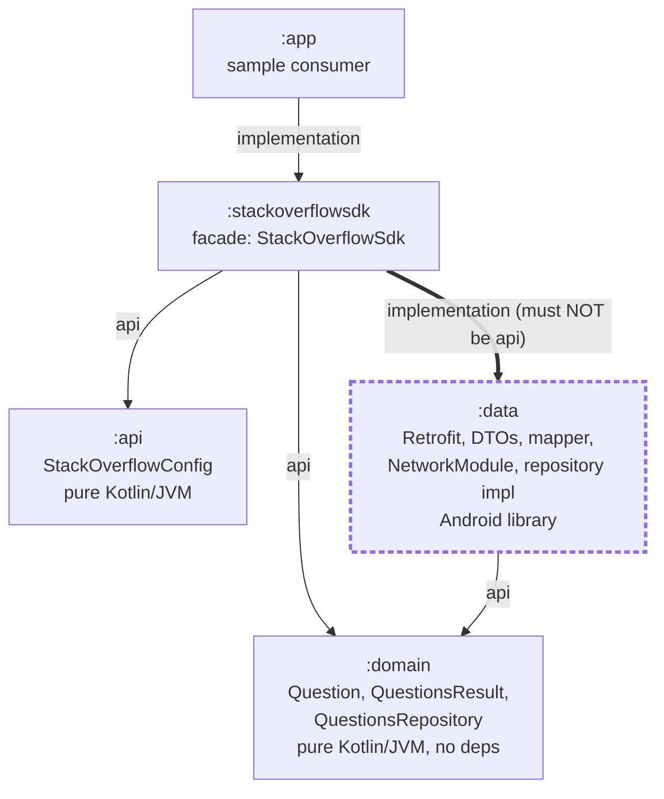
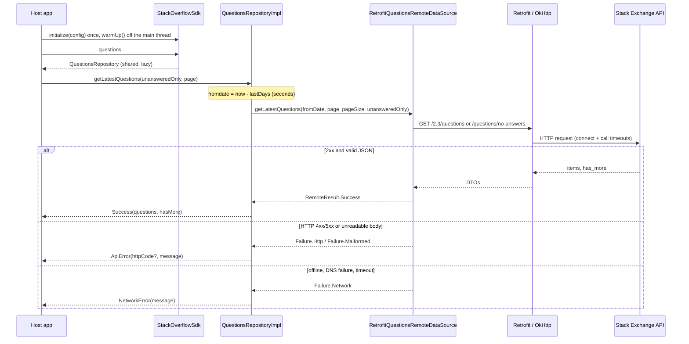
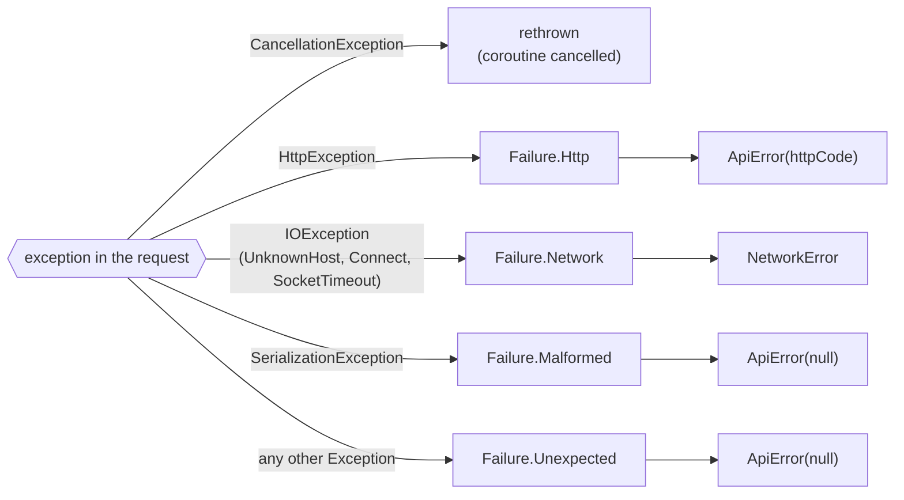
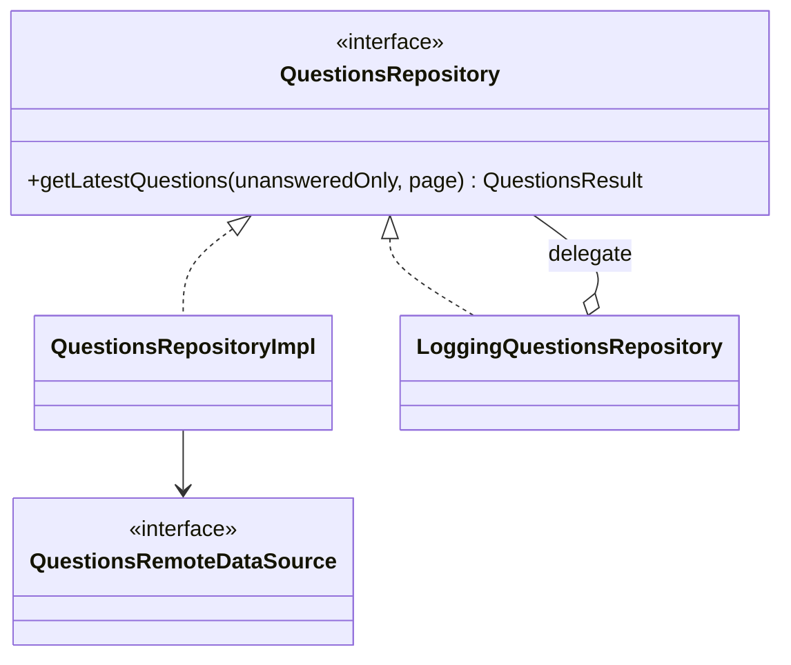

[← Back to the README](../README.md)

# Architecture

## Module dependencies

`api` edges are visible to the host app, `implementation` edges are not. The thick edge is the one
the IMPORTANT note below is about.

## Request flow

## Error mapping

Two steps, each with one responsibility. The data source is the only place that knows Retrofit's
exceptions; the repository only knows `RemoteResult`.

Only the first case leaves the SDK as an exception, and it is handled by the coroutines runtime.

- `:api` holds the public configuration (`StackOverflowConfig`), pure Kotlin/JVM.
- `:domain` is pure Kotlin/JVM with **zero third-party dependencies**. The repository contract only
  uses `suspend`, so it does not even expose coroutines.
- `:data` hides networking, in three small layers: `QuestionsRepositoryImpl` (public results) →
  `QuestionsRemoteDataSource` (an interface; transport failures as `RemoteResult`) → the Retrofit
  service. The repository does not import Retrofit, so the HTTP stack can be swapped or faked
  without touching it. Its only public symbol is `createQuestionsRepository()`.
- `:stackoverflowsdk` is the only module apps declare. It re-exports `:domain` with `api(...)`, so
  integrators get the models without declaring `:domain` themselves, and keeps `:data` as
  `implementation`, so integrators cannot see it.
- Rule: no `:data` type may appear in a public signature of the facade, otherwise `implementation`
  would not be enough.

> [!IMPORTANT]
> **`:data` must stay `implementation` in `:stackoverflowsdk/build.gradle.kts`, never `api`.**
> That single keyword is what keeps Retrofit, OkHttp, the DTOs and `createQuestionsRepository()`
> invisible to host apps. There is no opt-in marker or other safeguard behind it: if it were
> changed to `api(...)`, they would silently become part of the public API (and a breaking change
> every time they change). A comment in the build file warns about it, and a code review should
> reject any change to this line.

## Why is `createQuestionsRepository()` public?

Kotlin's `internal` is scoped to a **Gradle module**, so the facade cannot see `internal`
declarations of `:data`. The one symbol it needs, `createQuestionsRepository()`, must therefore be
`public`. A host app still cannot reach it: `:stackoverflowsdk` declares `:data` with
`implementation`, so the module is not on the app's compile classpath. The KDoc states that it is
not part of the supported API.

> A `@RequiresOptIn` marker would add a second layer of protection (useful if `:data` were ever
> exposed with `api(...)` or published as its own artifact). It was left out on purpose to keep the
> public surface and the amount of concepts small.

## Design patterns

Where each pattern is used in the SDK, and why. Only things that exist in the code are listed, and
they are labelled for what they are.

**Design patterns (GoF)**

| Pattern | Where | Why |
|---|---|---|
| **Facade** | `StackOverflowSdk` | One simple, stable entry point in front of Retrofit, DTOs, mappers and the HTTP client |
| **Singleton** (with limits) | `StackOverflowSdk` (`object`) | Configure once at startup (`initialize`) and share one client |
| **Decorator** | `LoggingQuestionsRepository` | Add logging around the repository without touching it, and only when enabled |

**Architectural patterns**

| Pattern | Where | Why |
|---|---|---|
| **Repository** + remote **data source** | `QuestionsRepositoryImpl` → `QuestionsRemoteDataSource` | The repository maps outcomes to public results; the data source owns the transport |
| **Dependency injection** by constructor, with a **composition root** | `createQuestionsRepository`, `NetworkModule` | The one place where the object graph is assembled, with no DI framework in the SDK |

**Idioms, not patterns:** sealed result types (`QuestionsResult`, `RemoteResult`) make errors values
the caller must handle instead of exceptions; mapping functions (`QuestionDto.toDomain()`) keep
the wire format out of the public model.

**Facade.** The SDK has several moving parts (Retrofit service, DTOs, mappers, HTTP client,
repository). The *facade* pattern hides them behind one simple, stable entry point,
`StackOverflowSdk`, which hands out a `QuestionsRepository`. The host app does not know what is
behind it, so internals can change (even the whole HTTP stack) without breaking integrators. For an
SDK this matters twice: it keeps the public surface minimal, and it gives one place to enforce
rules (validated config, no exceptions across the boundary).

**Singleton, with a conscious trade-off.** `StackOverflowSdk` is a Kotlin `object`: one well-known
access point that needs no instance and no `Context`, which is how most SDKs are configured once at
startup. Since `initialize` and the shared `questions` property exist, **it now holds state**, and that has
a price: global mutable state is harder to test and allows one configuration per process. How it is
contained:

- The shared state is tiny (the configuration and one repository) and guarded by a lock.
- `initialize` is **once-only**: later or late calls are ignored (and return `false`), so a running
  SDK never changes underneath its callers.
- Using `StackOverflowSdk.questions` without `initialize` falls back to the defaults, it never throws.
- `create(config)` still returns an **independent instance** ignoring the shared state: use it in
  tests, for several configurations, or with your own DI container (the sample app does this
  through Hilt).
- Tests reset the shared state through an `internal` function that is not part of the public API.

**Decorator.** `LoggingQuestionsRepository` is not a subclass of the real repository: it
**wraps** it. Both implement `QuestionsRepository`; the decorator holds the real one as `delegate`,
calls it, writes one log line and returns the same result. The caller cannot tell the difference.

The factory builds it only when there is somewhere to log: the host's `StackOverflowLogger` if
given, otherwise Logcat if `loggingEnabled` is `true`:
`LoggingQuestionsRepository(QuestionsRepositoryImpl(...), sink)`. Why a decorator and not logging
inside the repository or a subclass:

- **One responsibility per class**: the repository maps results and knows nothing about logging.
- **Zero cost when off**: with logging disabled the decorator is never created.
- **Testable alone**: its tests use a fake repository, no network.
- **No inheritance**: a subclass would depend on the base class internals and force it to be `open`.

The price: every new method of `QuestionsRepository` must also be added to the decorator. The
compiler enforces it, so it cannot be forgotten.
