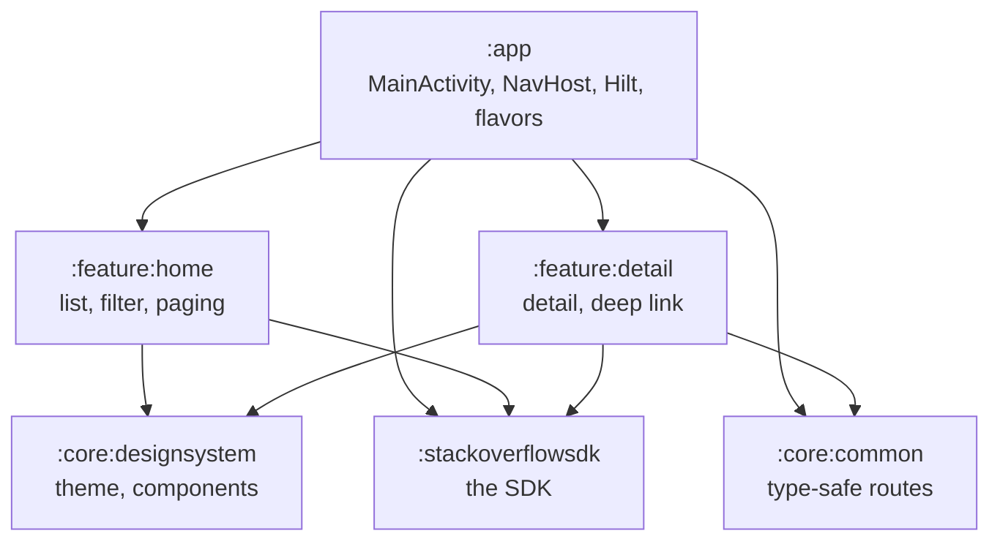

[← Back to the README](../README.md)

# Sample App

The app consumes the SDK like any third party would: through `StackOverflowSdk.initialize(...)` / `StackOverflowSdk.questions` and the
public contract only.

| Feature | Notes |
|---|---|
| Latest questions | Last 30 days, newest first, paginated (next page when scrolling near the end) |
| "Unanswered" filter | Chip; calls the dedicated `no-answers` endpoint, selection survives process death |
| Loading / empty / error | Spinner, empty message, network vs server error with **Retry** |
| Detail screen | Title, author, score, answers, tags; **Open in browser** button; loaded by id |
| Deep link | `stackoverflowdemo://question/{questionId}` opens the detail directly |

## Modules



Feature modules never depend on each other: navigation between them lives in `:app`, using the
routes from `:core:common`.

## Product flavors: `mock` and `real`

The flavor is chosen at build time; each one has its own Hilt `SdkModule` in `src/mock` or
`src/real`, so there is no runtime branching.

| Flavor | `SdkModule` binds | Use it when |
|---|---|---|
| `real` | `StackOverflowSdk.questions` (SDK initialized and warmed up at startup, logging in debug) | you want the real Stack Exchange API |
| `mock` | `FakeQuestionsRepository` (in-memory data, 800 ms latency) | offline, demos, UI work. **The SDK networking stack is never built.** |

`mock` has the application id suffix `.mock`, so both can be installed side by side.
Each flavor also has its own `SdkInitializer`: `real` configures the SDK and warms it up off the main
thread, `mock` does nothing, so no SDK code runs at all.

## Deep link

`stackoverflowdemo://question/{questionId}` opens the detail screen directly. It is declared twice,
as usual: a manifest `intent-filter` (`VIEW`, `BROWSABLE`) and a type-safe
`navDeepLink<Route.QuestionDetail>`. It works because the detail loads **by id**
(`getQuestion(id)` in the SDK): a link carries an id, not a question.

**Try it (emulator or device with USB debugging):**

1. Install the app: `./gradlew :app:installMockDebug` (or `:app:installRealDebug`).
2. Fire the link with `adb`. On macOS `adb` is in `~/Library/Android/sdk/platform-tools/` if it is
   not on your `PATH`.

```bash
# mock flavor: ids 1000..1019 exist, works offline
adb shell am start -a android.intent.action.VIEW \
  -d "stackoverflowdemo://question/1000" \
  -p com.alexfin90.stackoverflowhomeassignment.mock

# real flavor: use any StackOverflow question id, e.g. the number in a question URL
adb shell am start -a android.intent.action.VIEW \
  -d "stackoverflowdemo://question/80007692" \
  -p com.alexfin90.stackoverflowhomeassignment
```

- `-p <package>` selects the app. **Both flavors register the same link**, so if both are installed
  and you omit `-p`, Android shows an app chooser. That is expected.
- Expected result: the detail screen of that question (title, author, answers, tags, "Open in
  browser"). An id that does not exist shows the "does not exist" state, a missing network shows
  the error state with **Retry**.
- To check that the link is registered: `adb shell pm query-activities --brief -a
  android.intent.action.VIEW -d "stackoverflowdemo://question/1000"` lists the matching apps.
- Pressing Back after opening the link directly leaves the app (the graph is flat, see
  [Known limitations](roadmap-and-limitations.md#known-limitations)).

---

## Compose and architecture practices

- **Immutable UI state**: one `StateFlow` per screen of an `@Immutable` state (`sealed interface`
  for loading / error / empty / content), `ImmutableList` instead of `List`.
- **`LazyColumn` with stable `key` and `contentType`**, so items are reused and recomposition stays
  local.
- **State hoisting**: a stateful `*Route` (Hilt ViewModel, `collectAsStateWithLifecycle`) wraps a
  stateless `*Screen` that only takes state and callbacks. That makes screens testable and
  previewable.
- **No `Context` in ViewModels**: formatting with string resources and plurals happens in the UI
  layer.
- **Stale responses cannot win**: changing the filter cancels the in-flight request.
- **Design system without strings or SDK types**: components receive ready-to-render models.
- **Feature modules depend on the SDK contract only**, never on `:data`.
