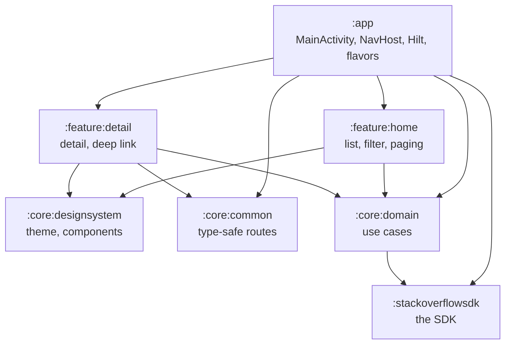
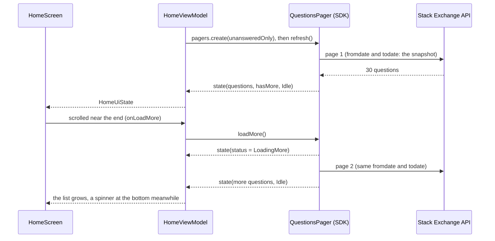

[← Back to the README](../README.md)

# Sample App

The app consumes the SDK like any third party would: through `StackOverflowSdk.initialize(...)` / `StackOverflowSdk.questions` and the
public contract only.

| Feature | Notes |
|---|---|
| Latest questions | Last 30 days, newest first, paginated (next page when scrolling near the end) |
| "Unanswered" filter | Chip; calls the dedicated `no-answers` endpoint, selection survives process death |
| Loading / empty / error | Spinner, empty message, network vs server error with **Retry** |
| Detail screen | Title, author, score, answers, tags; **Open in browser** button; loaded by id |
| Deep link | `stackoverflowdemo://question/{questionId}` opens the detail directly |

## Modules



Feature modules never depend on each other: navigation between them lives in `:app`, using the
routes from `:core:common`. They have no Gradle dependency on `:stackoverflowsdk` either: they reach
the SDK contract (the pager, `Question`, ...) through `:core:domain`, which re-exports it with `api`, and `:app`
provides the SDK to Hilt.

### Use cases (`:core:domain`)

One use case, **`GetQuestionUseCase`**: it loads a question by id and translates the SDK result
(`QuestionResult`) into the app's own `QuestionOutcome` / `LoadFailure`, so the detail feature never
sees the SDK's error types. It is a thin translation; it stays because it is the boundary between
the app and the SDK contract.

What is **not** here:

- **A use case for the list.** The paging (joining pages, removing duplicates, one request at a time,
  what to keep on failure) is done by the SDK's `QuestionsPager`, see below. It used to be a
  `LoadQuestionsPageUseCase` in the app and was removed when the logic moved into the SDK.
- A use case per call. One that only forwards a call adds a file and no logic.

The module is pure Kotlin/JVM; `GetQuestionUseCaseTest` runs without Robolectric.

### Paging: the SDK's `QuestionsPager`

The list is a `QuestionsPager` from the SDK ([how it works](sdk-api.md#paged-list-questionspager)).
`HomeViewModel` does not join pages or remove duplicates: it chooses the active pager, asks it to
load, and turns its state into what the screen shows.



- **One pager per filter.** The screen state is a single flow: the filter is the input and
  `flatMapLatest` gives each value its own pager. Toggling "Unanswered" cancels the inner flow of the old
  one, and with it its collector, its refresh and its loadMore, so a late answer of the previous filter
  can never reach the screen. The mapping to `HomeContent` runs on the injected `@DefaultDispatcher`
  (`:core:dispatcher`), and the state is shared with `SharingStarted.Lazily`: the pages already loaded
  stay while the app is in the background, instead of starting again from page 1 as `WhileSubscribed`
  would after its timeout.
- **State to screen** (`QuestionsPagerState` -> `HomeContent`):

| Pager state | Screen |
|---|---|
| has questions | the list; spinner at the bottom while `LoadingMore`; kept as it is on a refresh or a failed "load more" |
| no questions, `Failed(Network)` / `Failed(Api)` | error with Retry |
| no questions, loaded (`isLoaded`) | empty state |
| no questions, not loaded yet | full-screen spinner |

- **Scrolling.** `LoadMoreEffect` in `HomeScreen.kt` calls `onLoadMore` when the user is within 3
  items of the end (`snapshotFlow` over the `LazyListState`, so the list is not recomposed on every
  scroll frame). It is called on every such event; the pager ignores the calls it cannot serve.
- **No repeats, and why.** The list is ordered from the most recent. If a question is posted while
  the user scrolls, everything would slide down by one and the last question of a page would come
  back at the start of the next one (two items with the same `key` crash a `LazyColumn`). The pager
  avoids it by fixing the window when `refresh` runs: every page of that snapshot is requested with
  the same `fromdate` and `todate`, so a question posted afterwards is simply outside the window.
  De-duplicating by id stays as a safety net. A new question appears at the next refresh.
- **Limits.** A question **deleted** meanwhile makes the items slide up and one can be skipped
  between two pages. The loaded questions stay in memory for as long as the pager lives.

## Product flavors: `mock` and `real`

The flavor is chosen at build time; each one has its own Hilt `SdkModule` in `src/mock` or
`src/real`, so there is no runtime branching.

| Flavor | `SdkModule` binds | Use it when |
|---|---|---|
| `real` | `StackOverflowSdk.questions` (SDK initialized and warmed up at startup, logging in debug) | you want the real Stack Exchange API |
| `mock` | `FakeQuestionsRepository` (in-memory data, 800 ms latency) | offline, demos, UI work. **The SDK networking stack is never built.** |

`mock` has the application id suffix `.mock`, so both can be installed side by side.
Each flavor also has its own `SdkInitializer`: `real` configures the SDK and warms it up off the main
thread, `mock` does nothing, so no SDK code runs at all.

## Deep link

`stackoverflowdemo://question/{questionId}` opens the detail screen directly. It is declared twice,
as usual: a manifest `intent-filter` (`VIEW`, `BROWSABLE`) and a type-safe
`navDeepLink<Route.QuestionDetail>`. It works because the detail loads **by id**
(`getQuestion(id)` in the SDK): a link carries an id, not a question.

**Try it (emulator or device with USB debugging):**

1. Install the app: `./gradlew :app:installMockDebug` (or `:app:installRealDebug`).
2. Fire the link with `adb`. On macOS `adb` is in `~/Library/Android/sdk/platform-tools/` if it is
   not on your `PATH`.

```bash
# mock flavor: ids 1000..1019 exist, works offline
adb shell am start -a android.intent.action.VIEW \
  -d "stackoverflowdemo://question/1000" \
  -p com.alexfin90.stackoverflowhomeassignment.mock

# real flavor: use the id of an existing question (the number in its URL); 80007925 exists at the time of writing
adb shell am start -a android.intent.action.VIEW \
  -d "stackoverflowdemo://question/80007925" \
  -p com.alexfin90.stackoverflowhomeassignment
```

- `-p <package>` selects the app. **Both flavors register the same link**, so if both are installed
  and you omit `-p`, Android shows an app chooser. That is expected.
- Expected result: the detail screen of that question (title, author, answers, tags, "Open in
  browser"). An id that does not exist shows the "does not exist" state, a missing network shows
  the error state with **Retry**.
- To check that the link is registered: `adb shell pm query-activities --brief -a
  android.intent.action.VIEW -d "stackoverflowdemo://question/1000"` lists the matching apps.
- After opening the link directly, **both the back arrow and the system Back button go to the
  list**, they do not leave the app (checked on an emulator, by hand and with `input keyevent BACK`).

---

## Compose and architecture practices

- **Immutable UI state**: one `StateFlow` per screen of an `@Immutable` state (`sealed interface`
  for loading / error / empty / content), `ImmutableList` instead of `List`.
- **`LazyColumn` with stable `key` and `contentType`**, so items are reused and recomposition stays
  local.
- **ViewModel contract (`@Stable`)**: each `*Route` depends on an interface
  (`HomeViewModelContract`, `DetailViewModelContract`), with `hiltViewModel<...>()` as default. A
  concrete ViewModel is reported as *unstable* by the Compose tooling (it has mutable properties) and
  a screen taking it cannot be skipped; the `@Stable` interface can, and a fake can be passed in
  previews and tests without Hilt. Checked with the Compose compiler report: `HomeRoute` is
  `restartable skippable`.
- **One `Scaffold` for the whole app**, as `Theme { App }` -> `AppContent` -> `NavHost`:
  `StackOverFlowApp` (stateful: reads a `MainViewModelContract`) -> `StackOverFlowAppContent` (the
  **only** `Scaffold`, with the top bar) -> `StackOverFlowNavHost` (private, in the content of the
  `Scaffold`; it creates its own `NavHostController`, so no composable takes that unstable type as a
  parameter, and it only reports the current destination through a callback). The graph is written
  inside the `NavHost`. The back arrow of the top bar asks the system for "back" instead of using
  the controller, so the `Scaffold` does not need it. The screens have no `Scaffold` or top bar of
  their own. The `MainViewModel` owns the state of the part common to every destination (title and
  back arrow), driven by the current destination.
- **State hoisting**: a stateful `*Route` (Hilt ViewModel, `collectAsStateWithLifecycle`) wraps a
  stateless `*Screen` that only takes state and callbacks. That makes screens testable and
  previewable.
- **No `Context` in ViewModels**: formatting with string resources and plurals happens in the UI
  layer.
- **Stale responses cannot win**: changing the filter cancels the in-flight request.
- **Design system without strings or SDK types**: components receive ready-to-render models.
- **Feature modules depend on the SDK contract only**, never on `:data`.
