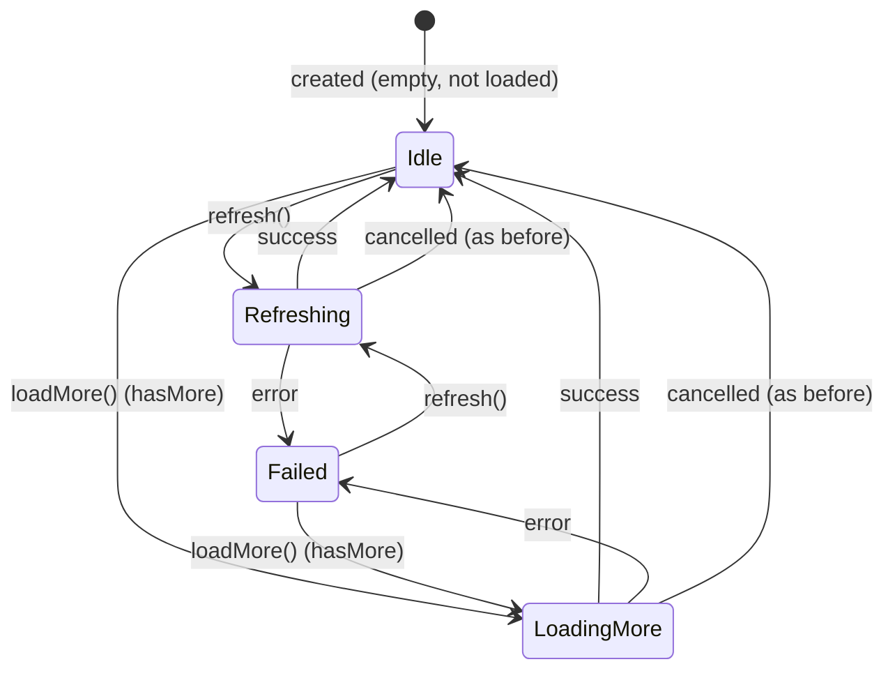

[← Back to the README](../README.md)

# Public API

```kotlin
// Add to your app
implementation(project(":stackoverflowsdk"))

// import com.alexfin90.stackoverflowsdk.StackOverflowSdk
// import com.alexfin90.stackoverflowsdk.api.StackOverflowConfig
// 1. Application.onCreate: configure once. Cheap, no I/O, no extra thread.
StackOverflowSdk.initialize(StackOverflowConfig(callTimeoutSeconds = 20, loggingEnabled = BuildConfig.DEBUG))
// 2. Optional: build the HTTP stack off the main thread so the first request is not slower.
applicationScope.launch { StackOverflowSdk.warmUp() }

// 3. Anywhere:
when (val result = StackOverflowSdk.questions.getLatestQuestions(unansweredOnly = true, page = 1)) {
    is QuestionsResult.Success      -> show(result.questions, canLoadMore = result.hasMore)
    is QuestionsResult.NetworkError -> showOffline(result.message)
    is QuestionsResult.ApiError     -> showError(result.httpCode, result.message)
}
```

`initialize` and `warmUp` are optional: `StackOverflowSdk.questions` works with the defaults. If you
prefer to own the instance (tests, DI container, several configurations), use
`StackOverflowSdk.create(config)` instead.

| Type | Role |
|---|---|
| `StackOverflowSdk.initialize(config)` | Sets the configuration once. Cheap. Returns `true` if applied, `false` if ignored (already initialized or already in use). |
| `StackOverflowSdk.questions` | Shared `QuestionsRepository`, built lazily and thread-safe. Uses the defaults if `initialize` was never called. |
| `StackOverflowSdk.warmUp()` | Builds the shared repository now. Idempotent. Call it **off the main thread**: the SDK creates no threads of its own. |
| `StackOverflowSdk.create(config)` | Independent repository, ignores `initialize`. Keep and reuse the instance. |
| `StackOverflowConfig` | `baseUrl`, `pageSize` (1..100), `lastDays` (30), `connectTimeoutSeconds` (10), `callTimeoutSeconds` (30), `loggingEnabled` (false). Validated at construction. |
| `QuestionsRepository` | `suspend fun getLatestQuestions(unansweredOnly, page): QuestionsResult` and `suspend fun getQuestion(id): QuestionResult` |
| `QuestionsResult` | Sealed: `Success(questions, hasMore)` / `NetworkError` / `ApiError(httpCode?, message)` |
| `QuestionResult` | Same idea for one question: `Success(question)` / `NotFound` / `NetworkError` / `ApiError` |
| `StackOverflowSdk.pagers` | Factory of `QuestionsPager`: a paged, growing list with its state (see below). |
| `QuestionsPager` | `state: StateFlow<QuestionsPagerState>`, `suspend refresh()`, `suspend loadMore()` |
| `Question` | Plain domain model, independent from the wire format. Title is already HTML-decoded. |

## Paged list: `QuestionsPager`

The repository gives **one page at a time** and keeps nothing between calls. A host that shows a
growing list has to join pages, remove duplicates and decide what happens on failure. The pager does
that inside the SDK:

```kotlin
val pager = StackOverflowSdk.pagers.create(unansweredOnly = true)
scope.launch { pager.state.collect { render(it) } }   // questions, hasMore, status
scope.launch { pager.refresh() }                       // first page
scope.launch { pager.loadMore() }                      // when the user nears the end
```

`QuestionsPagerState` has the `questions` loaded so far, `hasMore`, `isLoaded` (a page was loaded at
least once: it tells "nothing yet" from "loaded and empty") and a `status`:
`Idle`, `Refreshing`, `LoadingMore` or `Failed(Network | Api)`.

Rules (all covered by tests; the ones that matter were checked by breaking them on purpose):

- **Starts empty and idle**; call `refresh()` first. One pager per filter value.
- **One request at a time** (a `Mutex`). `loadMore()` returns at once if something is running or there
  is no next page, so calling it on every scroll event is safe. `refresh()` waits for its turn and
  replaces the list.
- **A snapshot of "now" is fixed at `refresh()`**: every page is requested with the same `fromdate`
  and `todate`. The window cannot slide while the user scrolls, so a question posted meanwhile
  cannot shift the pages or come back twice. De-duplicating by id is kept as a safety net.
- **Failures are values**: `Failed(Network)` or `Failed(Api)`. The questions already loaded are kept,
  and calling again retries the same page.
- **No threads, no scope**: the calls run in the coroutine of the caller. Cancelling it cancels the
  request and restores the state as it was; the lock is released.



Trade-offs, stated openly:

- **State in the public API.** The SDK was stateless on purpose; the pager is the one object that
  holds state (the loaded list). It is created by the caller, which decides how long it lives.
- **`kotlinx-coroutines` is now a public dependency** of the SDK (`StateFlow` is in the API). It is
  one more version that can clash with the host's, see [dependency conflicts](dependency-conflicts.md).
- **Memory grows** with the pages loaded; there is no cap.
- A question **deleted** while scrolling can be skipped between two pages.

## Initialization rules

1. **Only the first `initialize` takes effect**, and only if the shared repository was not used yet.
   Any other call returns `false` and, if logging is enabled, logs a warning. The configuration of a
   running SDK never changes.
2. **Using the SDK without `initialize` is safe**: the defaults apply, nothing throws. The first
   access then freezes that default configuration.
3. **`initialize` does not block**: it validates and stores the configuration. The expensive part
   (OkHttp client, Retrofit) is built on first use or in `warmUp()`, on the caller's thread.

## Logging

Off by default: a library should be silent unless the host asks.

```kotlin
// Logcat, tag "StackOverflowSdk"
StackOverflowConfig(loggingEnabled = BuildConfig.DEBUG)
```

One line per request, for example
`getLatestQuestions(unansweredOnly=true, page=2) -> Success(items=20, hasMore=true) in 312 ms`.
`DEBUG` for success, `WARN` for no connection, `ERROR` for an API error.

- **What is logged**: the operation, its parameters, the kind of outcome, counts and duration.
- **What is never logged**: response bodies, titles, authors, or exception messages (they can echo
  server content). This is covered by a test.
- **Logging cannot break the SDK**: a failure while writing the line (e.g. Logcat unavailable) is
  swallowed.
- **No custom logger on purpose**: a switch is enough for the need, and a pluggable logger would be
  one more public type to keep stable. If a host needs to route the lines elsewhere (Timber, a file),
  an optional `logger` parameter can be added later without breaking anyone.
- Implemented as a decorator (`LoggingQuestionsRepository`) that is only created when logging is
  enabled, so the default path pays nothing and the repository stays free of logging code.

## Coroutine cancellation

`getLatestQuestions` is cancellable and rethrows `CancellationException` instead of converting it
to a result: swallowing it would leave a cancelled coroutine running. It can happen when:

- the user leaves the screen while the request is in flight and `viewModelScope` is cancelled;
- the user changes the filter and the previous job is cancelled (`collectLatest`, `Job.cancel()`);
- a `withTimeout` expires (`TimeoutCancellationException` is a subclass);
- a `LaunchedEffect` in Compose leaves the composition or its key changes.

It never crashes the host: the coroutines runtime handles it. It is the only exception that can
leave the SDK.

## Design decisions

- **Errors are values, not exceptions.** An exception thrown by the SDK would show up as a crash of
  the *host* app. The data source catches everything (including the unexpected) and turns it into
  a `RemoteResult`; the repository maps that to a `QuestionsResult`. The only exception rethrown is
  `CancellationException`, to respect structured concurrency.
- **No `Context`; initialization is optional and non-blocking.** `initialize` only stores a
  validated configuration, so nothing blocks the host's startup or leaks an `Activity`.
- **Config validated eagerly.** An invalid configuration is a programming error in the host, so it
  fails fast with a clear message instead of failing at the first request.
- **Unanswered filter uses the dedicated endpoint** (`/questions/no-answers`) so the filtering is
  done by the server and pagination stays correct.
- **Paging is in the SDK** (`QuestionsPager`), not in each app: joining pages, the snapshot window and
  the failure rules are written and tested once.
- **No DI framework inside the SDK.** Hilt/Dagger would be imposed on the host (annotation
  processing, application class, version conflicts). Testability comes from plain constructor
  injection (`QuestionsRepositoryImpl` receives its data source, the data source receives the service). Hilt is a good fit for the *sample
  app*, where it will be used.
- **Timeouts are explicit.** Connect timeout (default 10 s) makes the SDK fail fast on a dead
  network; call timeout (default 30 s) caps the whole request. A timeout is an `IOException`, so it
  becomes `QuestionsResult.NetworkError`, same as offline or DNS failure (`UnknownHostException`).
- **`:data` is an Android library, `:domain` is pure JVM.** Only the contract needs to be
  framework-free. `:data` uses `Html.fromHtml` to decode HTML entities in titles; its tests run
  with Robolectric.
- **No offline cache.** Out of scope: the SDK stays stateless (a database would add dependencies
  and conflict risk). A cache would live in the app (e.g. Room as source of truth with a fallback
  on `NetworkError`) or as an optional OkHttp HTTP cache.
- **`minSdk` 24**, to keep the SDK integrable by apps with a low minimum.
- **INTERNET permission** is declared in the SDK manifest and merged into the host app.
